# Compare images

`SkiaSharp.Testing` compares decoded `SKImage`, `SKBitmap` or `SKPixmap` objects.
Use it to check rendered output, allow small differences and save diagnostic
images when a test fails.

## Getting started

Install `SkiaSharp.Testing` alongside the matching SkiaSharp release and your
application's existing native-assets setup:

```bash
dotnet add package SkiaSharp.Testing
```

> [!IMPORTANT]
> This API is experimental and may change between releases.
> Opt in by suppressing the `SKIA4001` diagnostic:

```xml
<PropertyGroup>
  <NoWarn>$(NoWarn);SKIA4001</NoWarn>
</PropertyGroup>
```

## Compare two images

| Expected | Actual |
| --- | --- |
| 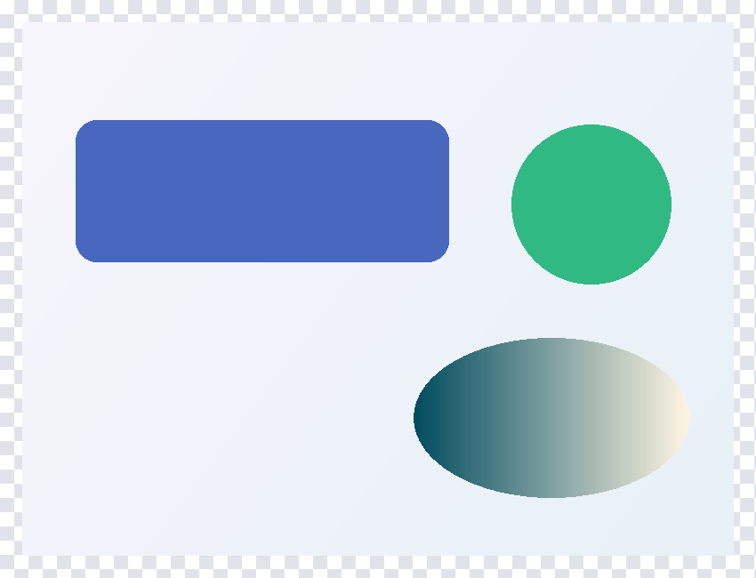 | 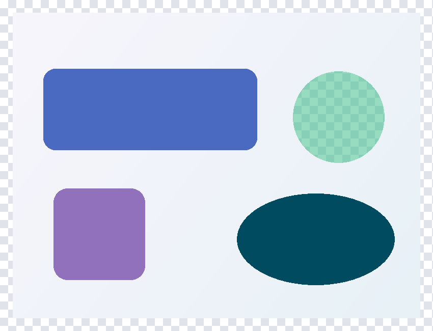 |

The panel has a small color change, the circle has a transparency change,
the square is new, and the ellipse's gradient has been replaced with a solid fill.

```csharp
using System.IO;
using SkiaSharp;
using SkiaSharp.Testing;

using var expected = SKImage.FromEncodedData("expected.png");
using var actual = SKImage.FromEncodedData("actual.png");
var result = SKImageComparison.Compare(expected, actual);
if (!result.IsMatch)
{
    using var difference = SKImageComparison.GenerateDifferenceImage(expected, actual);
    using var png = difference.Encode(SKEncodedImageFormat.Png, 100);
    File.WriteAllBytes("difference.png", png.ToArray());
}
```

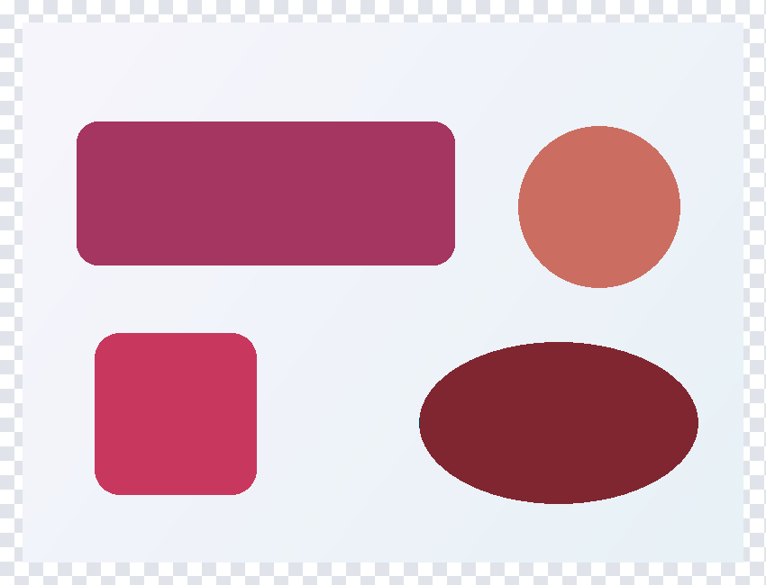

Defaults are exact RGBA after normalization to unpremultiplied 8-bit pixels.
The default diagnostic blends red highlights over the actual image, preserving
detail. Inputs must have equal, nonempty dimensions and readable pixels.
Control capture size, scale, fonts and animation time before comparison.

## Allow small differences

Tolerance decides **which pixels mismatch**. A pixel mismatches if any enabled
channel exceeds its allowance:

```csharp
var options = new SKComparisonOptions
{
    RedTolerance = SKPixelTolerance.Absolute(2),
    GreenTolerance = SKPixelTolerance.Absolute(2),
    BlueTolerance = SKPixelTolerance.Absolute(2),
    AlphaTolerance = null,
};
var result = SKImageComparison.Compare(expected, actual, options);
using var difference = SKImageComparison.GenerateDifferenceImage(
    expected, actual, options: options);
using var png = difference.Encode(SKEncodedImageFormat.Png, 100);
File.WriteAllBytes("difference-tolerant.png", png.ToArray());
```


The panel's two-level RGB change is now amber-tinted. Alpha is disabled, so the
circle is not highlighted; the square and ellipse still mismatch. Generate the
diagnostic with the same options as the comparison.

`null` disables a channel; zero requires an exact match. `Absolute` uses byte
levels, and tolerance `Percent` uses percentage points of the full 255 range.
Boundaries are inclusive.

## Set a mismatch budget

A budget decides **how many mismatches are acceptable**, after tolerance has
classified the pixels. Starting with the options above:

```csharp
options.MismatchBudget = SKPixelMismatchBudget.Pixels(20);
var result = SKImageComparison.Compare(expected, actual, options);
```

| Budget | Meaning |
| --- | --- |
| `Pixels(20)` | At most 20 mismatched pixels |
| `Percent(0.2)` | At most 0.2% of compared pixels, not a fraction of 0.2 |
| `Both(20, 0.2)` | Both limits must pass |

Count limits are inclusive; percentage limits floor to a whole-pixel count.
With no budget or magnitude gate, zero pixels may mismatch.

Budgets affect `IsMatch`, not the diagnostic colors. A passing comparison
can still contain highlighted mismatches.

For a magnitude-based gate instead, set `MaxNormalizedMeanAbsoluteError` or
`MaxNormalizedRootMeanSquaredError` from 0 to 1. A normalized MAE limit of `0.01`
allows an average absolute channel difference of 2.55 byte levels, not 1%
mismatched pixels. All configured gates must pass; a magnitude-only gate does
not limit the mismatch count.

`RawMetrics` includes errors before tolerance filtering. `ThresholdedMetrics`
zeros tolerated differences but retains the full magnitude of exceeding errors.
Both use `ComparedPixelCount * ChannelCount` samples.

## Choose a diagnostic

Pass `SKDifferenceStyle` to `GenerateDifferenceImage`:

| Actual | Threshold overlay (default) | Threshold map |
| --- | --- | --- |
|  | 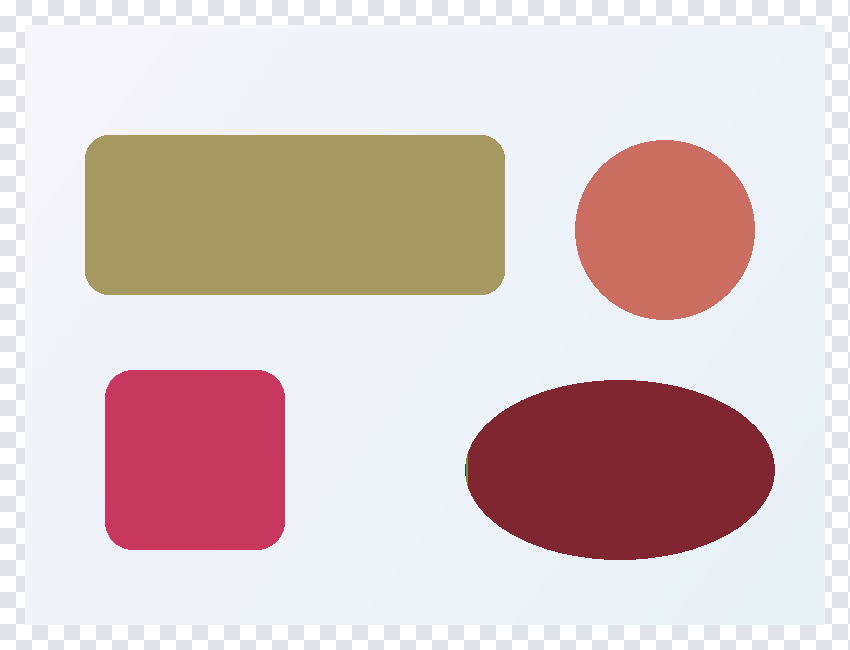 | 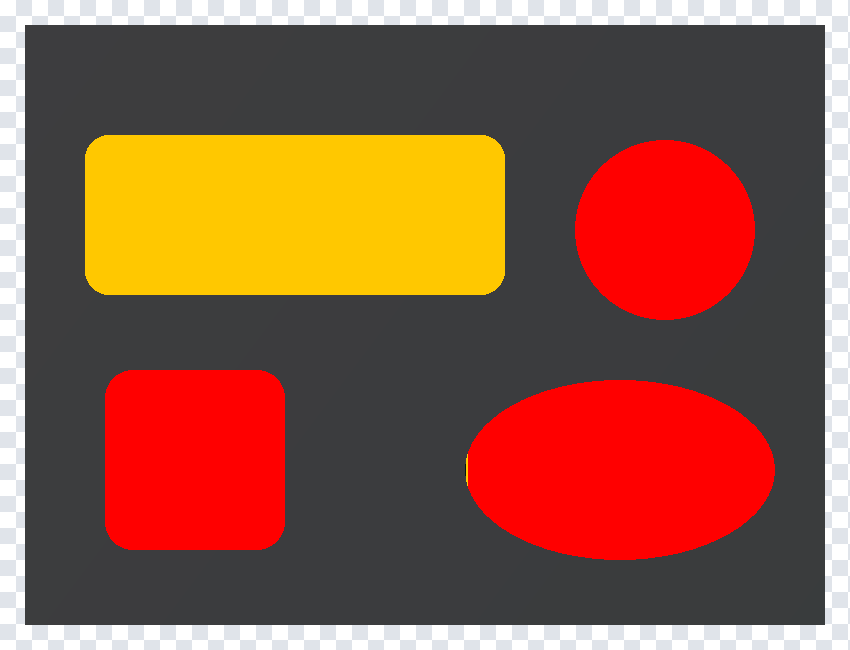 |

| Binary mask | Channel difference | Heatmap |
| --- | --- | --- |
| 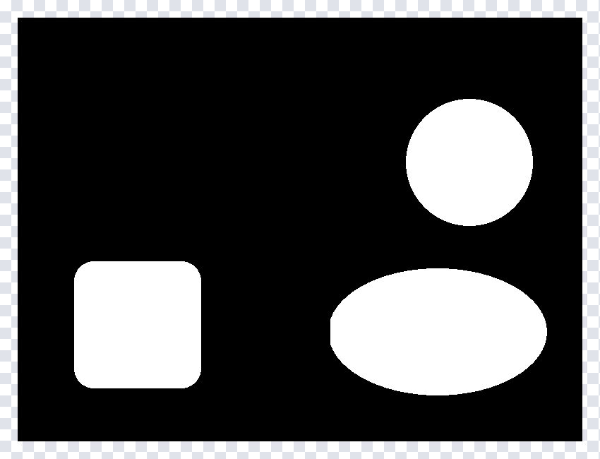 | 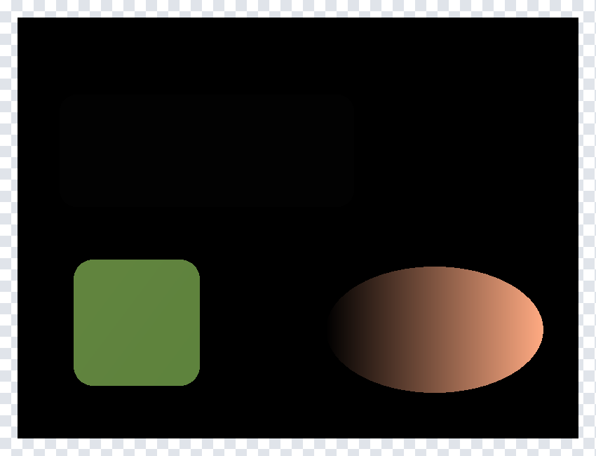 | 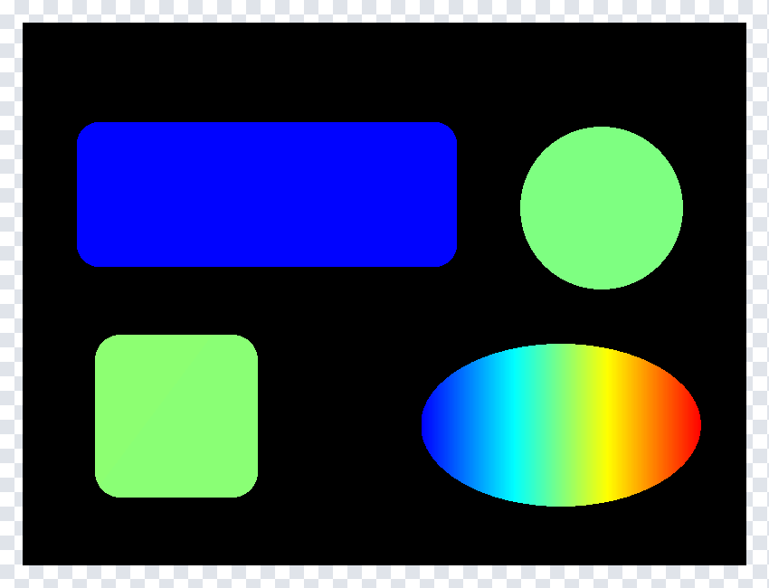 |

These examples use RGB tolerance **2** and exact alpha:

- `ThresholdOverlay` tints mismatches red, tolerated differences amber and ignored
  pixels gray at 50% over the actual image, flattening transparency onto white.
- `ThresholdMap` uses solid red, amber and gray, with dimmed actual colors for
  exact matches.
- `BinaryMask` shows mismatches in white and everything else in black.
- `ChannelDifference` shows raw RGB differences, including disabled RGB channels,
  but cannot represent alpha differences.
- `Heatmap` colors the largest raw enabled-channel difference on a fixed 0–255
  scale: blue through cyan and yellow to red. Exact matches are black; ignored
  pixels are gray.

Both magnitude styles show tolerated differences too. All diagnostic images are opaque.

## Alpha-only differences

The circle's RGB is unchanged; only its alpha changes. RGBA comparison detects
the change, while a raw RGB difference image cannot show it:

| RGBA overlay | RGB difference |
| --- | --- |
|  |  |

`ChannelDifference` cannot show the circle's alpha delta, although the other
RGB changes remain visible. Exclude alpha only intentionally. Comparing
premultiplied RGB can still reflect opacity even when alpha is disabled.

## Tolerance and ignore masks

Masks are `SKImage` objects with the same dimensions as the inputs. These
examples use exact RGB and `AlphaTolerance = null`.

### Tolerate a region

| Tolerance mask | Overlay |
| --- | --- |
|  | 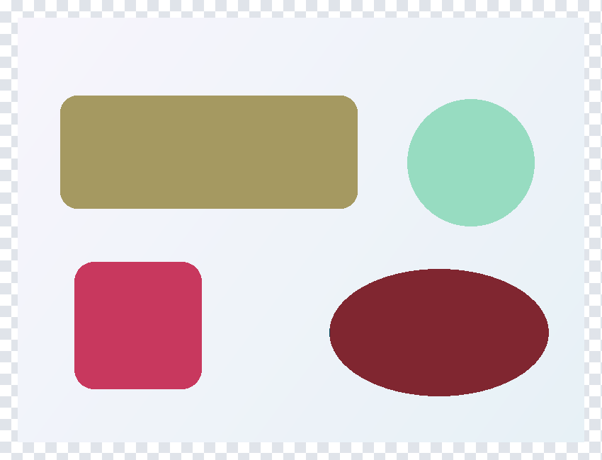 |

`ToleranceMask` widens each enabled channel's allowance using that mask byte.
The panel's RGB **(32, 32, 32)** allows 32 levels there; black outside allows zero.
The panel's two-level RGB differences are tolerated but stay in raw measurements
and the sample denominator. Mask alpha is an alpha allowance, not coverage.

### Exclude a region

| Ignore mask | Overlay |
| --- | --- |
| 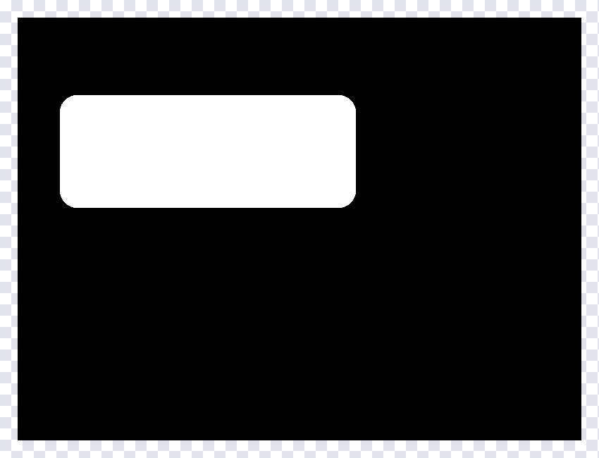 | 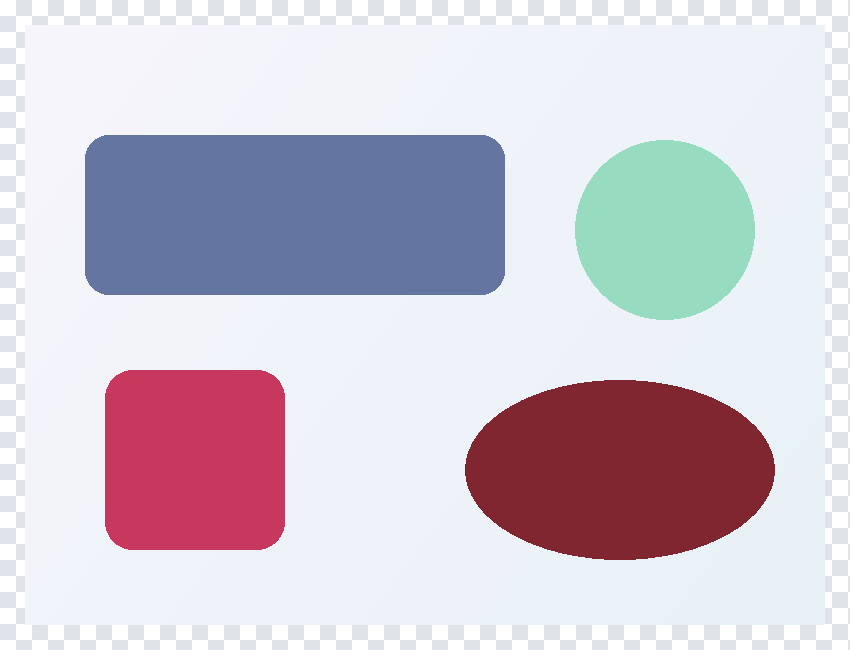 |

`IgnoreMask` removes entire pixels: black compares, any nonzero decoded RGB
excludes, independently of mask alpha. The panel contributes no errors, bounds,
maxima or metric samples. The square and ellipse remain mismatches in both examples.

`TotalPixels` is the full image area; fractions and budgets use
`ComparedPixelCount`. At least one pixel must remain compared. Inputs and masks
must remain alive and unmodified during a call; dispose returned diagnostic images.
