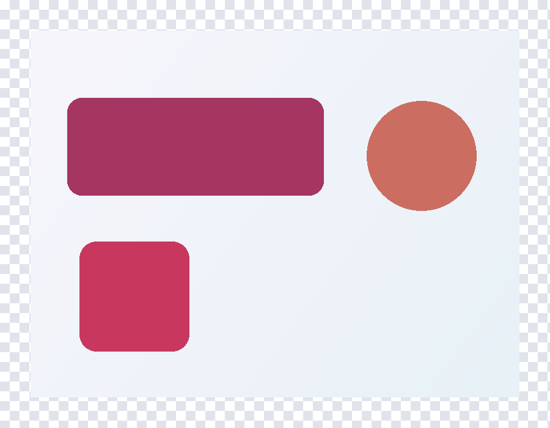
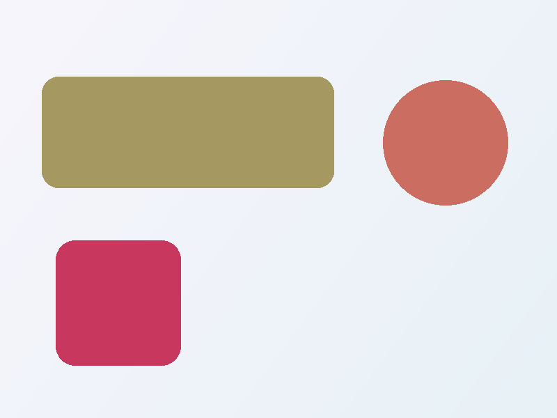
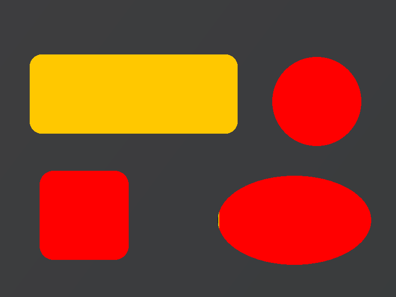
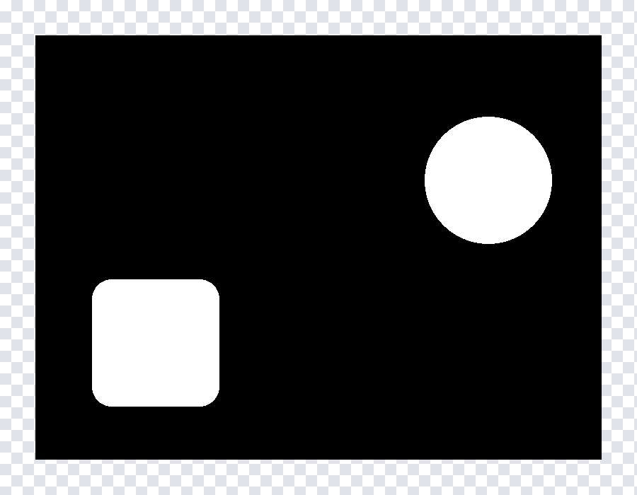
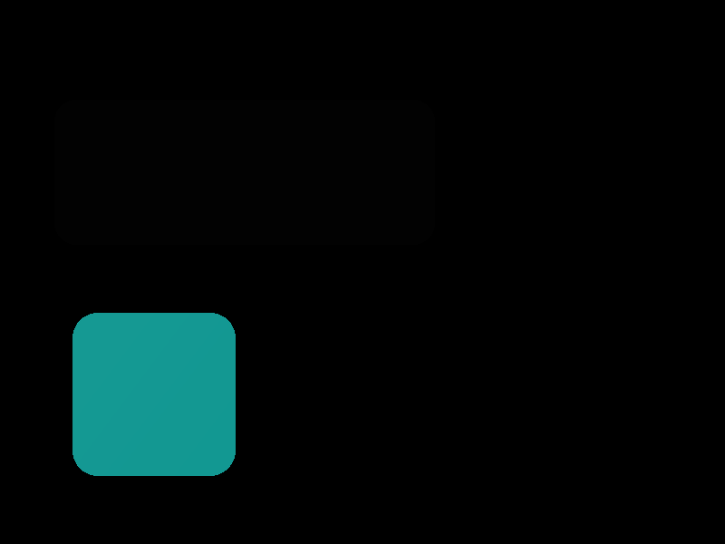
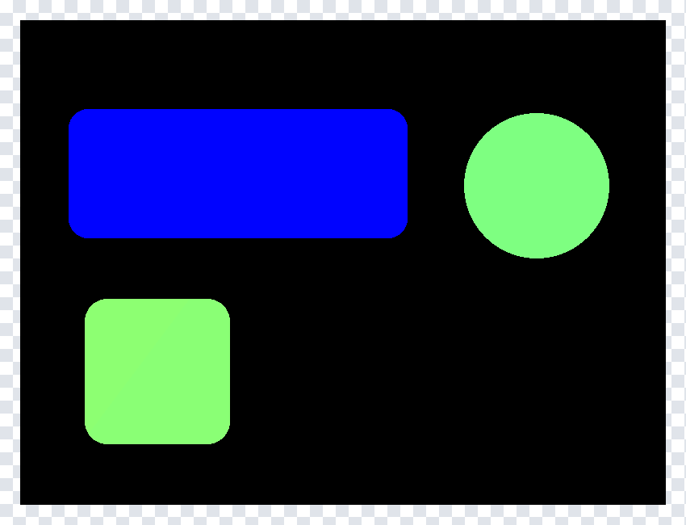
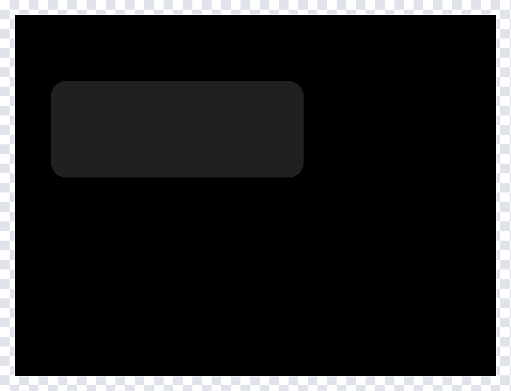
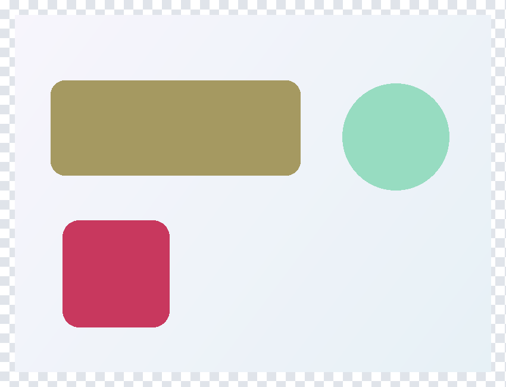
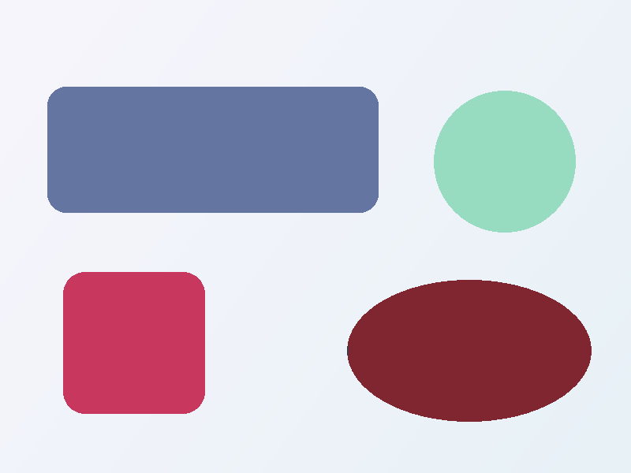

# Compare images

`SkiaSharp.Testing` compares decoded `SKImage`, `SKBitmap` or `SKPixmap` objects.
It measures differences, evaluates acceptance limits and generates diagnostics.
Capture, resizing, reference selection and test assertions remain the caller's
responsibility.

## Getting started

Install `SkiaSharp.Testing` alongside the matching SkiaSharp release and your
application's existing native-assets setup:

```bash
dotnet add package SkiaSharp.Testing
```

> [!IMPORTANT]
> This API is experimental and may change between releases, including releases
> with stable package versions. Opt in to `SKIA4001`; no preview SDK or runtime
> is required.

```xml
<PropertyGroup>
  <NoWarn>$(NoWarn);SKIA4001</NoWarn>
</PropertyGroup>
```

## Compare two images

| Expected | Actual |
| --- | --- |
|  |  |

The panel has a small color change, the circle has a transparency change,
and the square is new.

```csharp
using System.IO;
using SkiaSharp;
using SkiaSharp.Testing;

using var expected = SKImage.FromEncodedData("expected.png");
using var actual = SKImage.FromEncodedData("actual.png");
var result = SKPixelComparer.Compare(expected, actual);
if (!result.IsMatch)
{
    using var difference = SKPixelComparer.GenerateDifferenceImage(expected, actual);
    using var png = difference.Encode(SKEncodedImageFormat.Png, 100);
    File.WriteAllBytes("difference.png", png.ToArray());
}
```



Defaults are exact RGBA after normalization to unpremultiplied 8-bit pixels.
The default diagnostic blends red highlights over the actual image, preserving
detail. Inputs must have equal, nonempty dimensions and readable pixels.
Control capture size, scale, fonts and animation time before comparison.

## Allow small differences

Tolerance decides **which pixels mismatch**. A pixel mismatches if any enabled
channel exceeds its allowance:

```csharp
var options = new SKPixelComparerOptions
{
    RedTolerance = SKPixelTolerance.Absolute(2),
    GreenTolerance = SKPixelTolerance.Absolute(2),
    BlueTolerance = SKPixelTolerance.Absolute(2),
    AlphaTolerance = null,
};
var result = SKPixelComparer.Compare(expected, actual, options);
using var difference = SKPixelComparer.GenerateDifferenceImage(
    expected, actual, options: options);
using var png = difference.Encode(SKEncodedImageFormat.Png, 100);
File.WriteAllBytes("difference-tolerant.png", png.ToArray());
```


The +2 blue change is now amber-tinted. This example intentionally excludes alpha,
so the green circle is not highlighted; the violet square still mismatches. Always
generate the diagnostic with the same options as the comparison.

`null` disables a channel; zero requires an exact match. `Absolute` uses byte
levels, and tolerance `Percent` uses percentage points of the full 255 range.
Boundaries are inclusive.

## Set a mismatch budget

A budget decides **how many mismatches are acceptable**, after tolerance has
classified the pixels. Starting with the options above:

```csharp
options.MismatchBudget = SKPixelMismatchBudget.Pixels(20);
var result = SKPixelComparer.Compare(expected, actual, options);
```

| Budget | Meaning |
| --- | --- |
| `Pixels(20)` | At most 20 mismatched pixels |
| `Percent(0.2)` | At most 0.2% of compared pixels, not a fraction of 0.2 |
| `Both(20, 0.2)` | Both limits must pass |

Count limits are inclusive; percentage limits floor to a whole-pixel count.
With no budget or magnitude gate, zero pixels may mismatch.

| Budget below the measured mismatch count | Budget at the measured mismatch count |
| --- | --- |
|  |  |
| `IsMatch = false` | `IsMatch = true` |

The budget changes `IsMatch`, **not the diagnostic colors**. A passing comparison
can still contain highlighted mismatches.

For a magnitude-based gate instead, set `MaxNormalizedMeanAbsoluteError` or
`MaxNormalizedRootMeanSquaredError` from 0 to 1. A normalized MAE limit of `0.01`
allows an average absolute channel difference of 2.55 byte levels, not 1%
mismatched pixels. All configured gates combine with AND; an MAE-only or RMS-only
gate does not impose a hidden count restriction.

## Choose a diagnostic

Pass `SKPixelDifferenceStyle` to `GenerateDifferenceImage`:

| Style | Output |
| --- | --- |
| `ThresholdOverlay` (default) | 50% red/amber highlights over actual pixels; gray tint for ignored coverage |
| `ThresholdMap` | Solid red mismatches, amber tolerated differences, dimmed exact matches, gray ignored pixels |
| `BinaryMask` | White mismatches; black matches, tolerated and ignored pixels |
| `ChannelDifference` | Raw absolute RGB differences, including disabled RGB channels; no alpha visualization |
| `Heatmap` | Largest raw enabled-channel difference, from blue through cyan and yellow to red; black exact matches, gray ignored pixels |

| Threshold overlay | Threshold map |
| --- | --- |
|  |  |

| Binary mask | Channel difference |
| --- | --- |
|  |  |

These four examples use RGB tolerance **2** and exact alpha. The blue panel is
tolerated (amber), while the circle's alpha change and added square mismatch (red).
The binary mask therefore excludes the panel; raw RGB differences still show
its small change but cannot show the circle's alpha change.

Overlay highlights blend with the actual image, so their appearance depends on
the underlying colors. The returned diagnostic is opaque, with actual
transparency flattened onto white. Use `ThresholdMap` for solid classification
colors. These colors show status, not the magnitude of a difference.



`Heatmap` uses a fixed 0–255 scale, including tolerated differences and enabled
alpha differences. The same error always has the same color across images.

`RawMetrics` measures selected-channel differences before tolerance filtering.
`ThresholdedMetrics` zeros tolerated differences but retains full exceeding
magnitudes. Both use `ComparedPixelCount * ChannelCount` samples. Prefer helpers
such as `NormalizedMeanAbsoluteError` over manual denominators.

## Alpha-only differences

| Expected | Actual |
| --- | --- |
|  |  |

The circle's RGB is identical; only its alpha changes. Default RGBA comparison
detects it:

| RGBA overlay | RGB difference |
| --- | --- |
|  |  |

`ChannelDifference` cannot show the circle's alpha delta, although the other
RGB changes remain visible. Exclude alpha only intentionally. Comparing
premultiplied RGB can still reflect opacity even when alpha is disabled.

## Tolerance and ignore masks

Both masks are borrowed, same-size `SKImage` objects. These examples start with
exact RGB and `AlphaTolerance = null`.

### Tolerate a region

| Tolerance mask | Overlay |
| --- | --- |
|  |  |

`ToleranceMask` widens each enabled channel's allowance using that mask byte.
The panel's RGB **(32, 32, 32)** allows 32 levels there; black outside allows zero.
The +2 blue differences are tolerated but stay in raw measurements and the
sample denominator. Mask alpha is an alpha allowance, not coverage.

### Exclude a region

| Ignore mask | Overlay |
| --- | --- |
|  |  |

`IgnoreMask` removes entire pixels: black compares, any nonzero decoded RGB
excludes, independently of mask alpha. The panel contributes no errors, bounds,
maxima or metric samples. The added square remains a mismatch in both examples.

`TotalPixels` is the full image area; fractions and budgets use
`ComparedPixelCount`. Ignoring every pixel is invalid. Inputs and masks must
remain alive and unmodified during a call; dispose returned diagnostic images.
